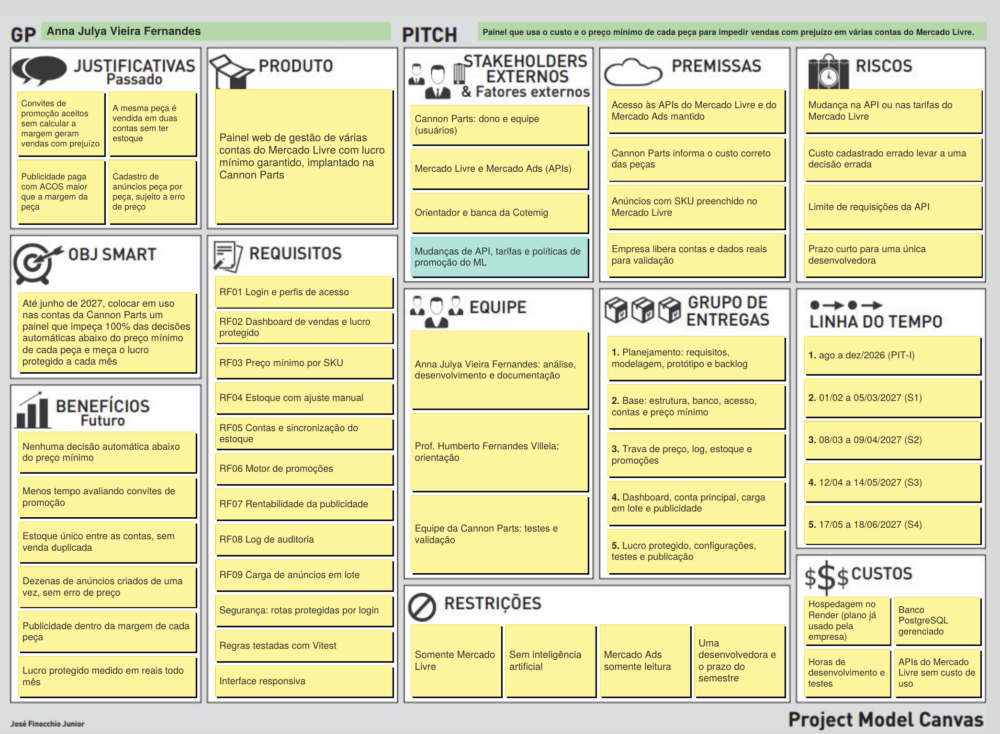

# Painel de Gestão de Contas do Mercado Livre · CannonParts

> Garante lucro mínimo em todas as decisões automáticas de venda, em várias contas do Mercado Livre ao mesmo tempo.

Projeto de Inovação Tecnológica (PIT) · Faculdade Cotemig · 2026/2



## Descrição do projeto

O sistema é um painel web para vendedores de autopeças que operam várias contas no Mercado Livre. Ele funciona como uma **camada de lucro** sobre o marketplace: o custo e o preço mínimo de cada peça viram uma regra que vale para todas as decisões automáticas, em todas as contas ao mesmo tempo.

Com essa regra, o sistema:

- aceita ou recusa sozinho os convites de promoção conforme a margem final;
- mantém um estoque único entre as contas, atualizado a cada venda;
- compara a margem de cada peça com o ACOS real da publicidade e recomenda o ACOS-alvo máximo;
- cria anúncios em lote a partir de uma planilha, rejeitando as linhas com preço abaixo do mínimo;
- registra cada decisão no log de auditoria e mostra no dashboard o lucro protegido no período.

O primeiro cliente é a **Cannon Parts**, loja de peças de moto que vende em várias contas do Mercado Livre.

## Problema abordado

O Mercado Livre não sabe quanto cada peça custou para o vendedor. Por isso, ele não consegue impedir que o vendedor:

- aceite um convite de promoção que dá prejuízo;
- venda em uma conta uma unidade que já foi vendida em outra;
- pague por publicidade um ACOS maior que a margem da peça.

Com milhares de SKUs e várias contas, avaliar essas decisões uma a uma deixa de ser viável. As ferramentas de mercado cuidam de partes separadas (preço, promoção, publicidade ou estoque), e a decisão continua manual.

## Objetivos

**Objetivo geral:** até junho de 2027, colocar em uso nas contas da Cannon Parts um painel que impeça 100% das decisões automáticas de venda abaixo do preço mínimo de cada peça e meça o lucro protegido a cada mês.

**Objetivos específicos:**

1. Centralizar custo, preço mínimo e estoque de cada SKU e bloquear qualquer preço abaixo do mínimo.
2. Sincronizar o estoque entre as contas, deixando as últimas unidades só na conta principal.
3. Decidir automaticamente os convites de promoção a partir da margem final.
4. Analisar a rentabilidade da publicidade comparando a margem com o ACOS real.
5. Criar anúncios em lote com validação prévia de cada linha.
6. Registrar todas as decisões automáticas e medir o lucro protegido.

## Integrantes da equipe

| Nome | Papel |
|---|---|
| Anna Julya Vieira Fernandes | Análise, desenvolvimento e documentação |
| Prof. Humberto Fernandes Villela | Orientador |

## Tecnologias previstas

| Camada | Tecnologias |
|---|---|
| Frontend | React, TypeScript, Vite, Tailwind CSS, shadcn/ui, TanStack Query, Recharts |
| Backend | Node.js, Express, leitura de planilhas (xlsx), tarefas agendadas |
| Banco de dados | PostgreSQL (modelo documentado no MySQL Workbench) |
| Integrações | API do Mercado Livre (OAuth 2.0) e API do Mercado Ads (somente leitura) |
| Infraestrutura e qualidade | Docker, Render, Vitest, Git e GitHub |

## Estrutura do repositório

```
frontend/   painel web (React + TypeScript + Vite)
backend/    API (Node.js + Express), motores de decisão e tarefas agendadas
docs/       documentação do PIT
  backlog/          Product Backlog priorizado (.docx e .pdf)
  canvas/           Project Model Canvas (.pdf e .png)
  banco-de-dados/   DER v2 (script SQL e imagem)
  diagramas/        arquitetura, classes e casos de uso
  prototipo/        protótipo navegável (abrir no navegador)
```

## Product Backlog

O backlog tem 21 itens e 99 story points, priorizados pelo MoSCoW e organizados em quatro sprints no PIT-II. A versão de entrega está em [`docs/backlog/Product_Backlog_Priorizado.docx`](docs/backlog/Product_Backlog_Priorizado.docx), e a visão resumida em [`docs/backlog/README.md`](docs/backlog/README.md). Cada item do backlog também está cadastrado como issue neste repositório.

| Sprint | Período | Itens | Pontos |
|---|---|---|---|
| S1 | 01/02 a 05/03/2027 | PB-01 a PB-05 | 22 |
| S2 | 08/03 a 09/04/2027 | PB-06 a PB-10 | 29 |
| S3 | 12/04 a 14/05/2027 | PB-11 a PB-15 | 29 |
| S4 | 17/05 a 18/06/2027 | PB-16 a PB-21 | 19 |

## Fluxo de trabalho

- A branch `main` guarda sempre a versão estável.
- Cada item do backlog é desenvolvido em uma branch própria, com o código do item no nome (por exemplo, `feature/PB-05-preco-minimo`).
- O código entra na `main` por pull request, depois dos testes.
- As mensagens de commit citam o item do backlog (por exemplo, `PB-05: valida preço mínimo maior que zero`).

## Situação

Fase de planejamento (PIT-I). A implementação começa no PIT-II (fevereiro a junho de 2027), em quatro sprints, conforme o backlog.
